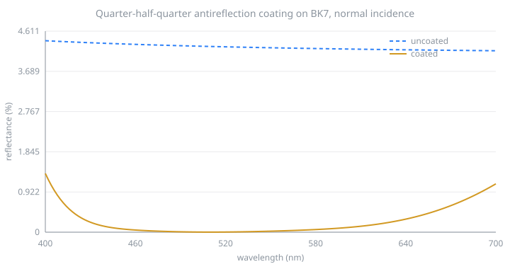
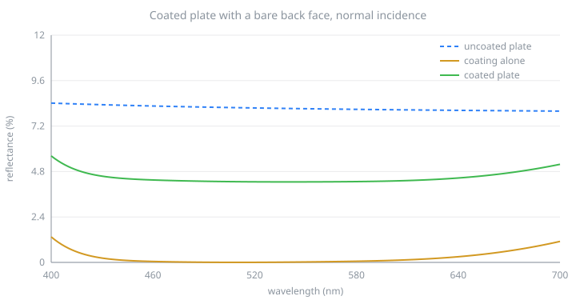
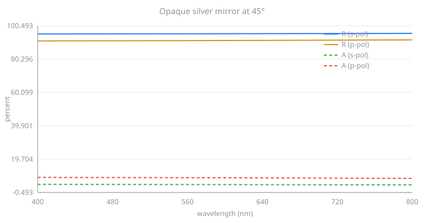
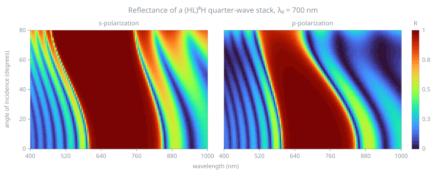
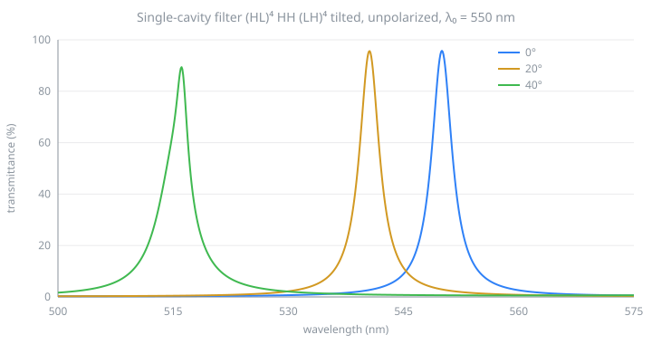
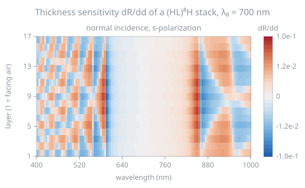
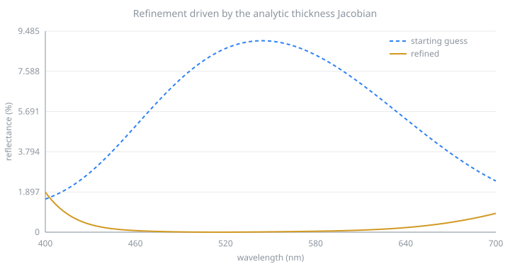
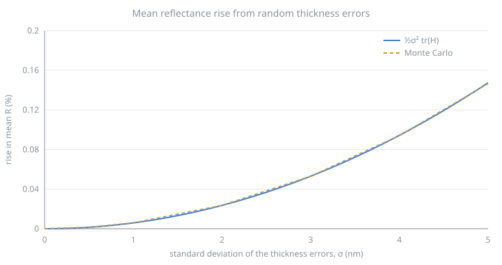
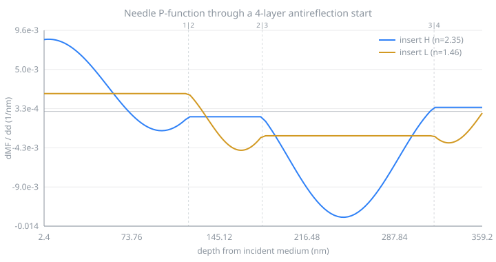
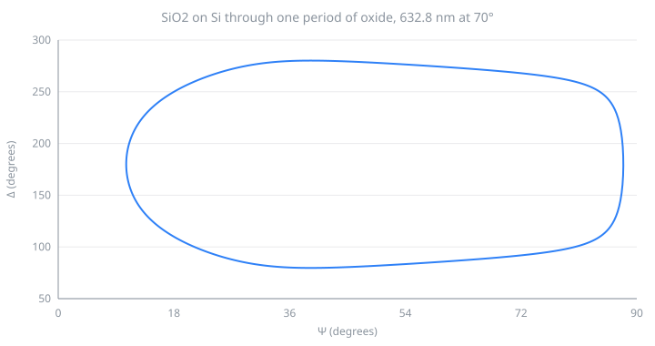

# Examples

Each script runs from a clone, and each figure on this page was written by its script. The documentation build reruns every script and fails if a figure changes.

```bash
git clone https://github.com/aai2k/tmmcore
cd tmmcore
node examples/01-single-layer.mjs
```

`npm run examples` runs all twelve in order.

| | Example | Calls |
|---|---|---|
| 01 | [A single layer, against the closed form](#a-single-layer-against-the-closed-form) | `rta` |
| 02 | [An antireflection coating](#an-antireflection-coating) | `rtaSpectrum` |
| 03 | [A coated plate with a bare back face](#a-coated-plate-with-a-bare-back-face) | `rtaSpectrum` |
| 04 | [A metal mirror at oblique incidence](#a-metal-mirror-at-oblique-incidence) | `rtaSpectrum` |
| 05 | [Wavelength against angle of incidence](#wavelength-against-angle-of-incidence) | `rta`, `rtaSpectrum` |
| 06 | [A narrowband filter, tilted](#a-narrowband-filter-tilted) | `rta`, `rtaSpectrum` |
| 07 | [Which layer controls which wavelength](#which-layer-controls-which-wavelength) | `rta`, `jacobian`, `jacobianSpectrum` |
| 08 | [Refinement with the analytic Jacobian](#refinement-with-the-analytic-jacobian) | `rtaSpectrum`, `jacobianSpectrum` |
| 09 | [What thickness errors cost, from the exact Hessian](#what-thickness-errors-cost-from-the-exact-hessian) | `rtaSpectrum`, `hessianSpectrum` |
| 10 | [The needle P-function: where the next layer goes](#the-needle-p-function-where-the-next-layer-goes) | `rtaSpectrum`, `tmmNeedleScan` |
| 11 | [Ellipsometry of an oxide on silicon](#ellipsometry-of-an-oxide-on-silicon) | `phase` |
| 12 | [Group delay, against a closed form](#group-delay-against-a-closed-form) | `phase`, `phaseSpectrum`, `phaseJacobian`, jet arithmetic |

---

## A single layer, against the closed form

`examples/01-single-layer.mjs`

A quarter-wave layer on a substrate at normal incidence has an exact reflectance (Macleod, *Thin-Film Optical Filters* 5th ed., Eq. 4.5):

$$R = \left(\frac{n_0 n_s - n_1^2}{n_0 n_s + n_1^2}\right)^2$$

```
quarter-wave thickness   99.6377 nm
R from tmmcore           0.012600790214630274
R closed form            0.012600790214630288
difference               1.39e-17
R + T + A                1.0000000000000000

bare glass R             4.26 %
coated R                 1.26 %
```

---

## An antireflection coating

`examples/02-ar-coating.mjs`

The quarter-half-quarter design at 510 nm: a quarter wave of low index facing air, a half wave of high index, and a quarter wave of intermediate index against the substrate. The half-wave layer is an absentee at 510 nm and flattens the response either side of it.



```
mean R, bare glass   4.245 %
mean R, coated       0.248 %
peak R, coated       1.348 %
```

The indices are Cauchy formulas, not measured data. tmmcore takes whatever index it is given at each wavelength.

---

## A coated plate with a bare back face

`examples/03-coated-plate.mjs`

Put the antireflection coating from the example above on one face of a glass plate, leave the other face bare, and a spectrophotometer reads far more than the coating's own curve. The back face reflects too, and the trip to it and back is far longer than the coherence length of the measuring beam, so the two faces add in irradiance, not in amplitude. Each face is computed on its own and the beams bouncing between them are summed (Macleod, *Thin-Film Optical Filters* 5th ed., §2.14):

$$R = R_a^+ + \frac{T_a^2\,R_b^+}{1 - R_a^-\,R_b^+}$$

$a$ is the coated front face, $b$ the bare back face, $+$ light going into the plate and $-$ light coming back out. $R_a^-$ is the coating seen from inside the glass: the same layers in reverse order, with the glass as the incident medium and air as the substrate. The sum has no loss in the glass, so the plate's internal transmittance is 1, as it is for glass with $k = 0$.



```
coating of example 02 on the front of a thick plate, back face bare, normal incidence
coating from the glass side against the air side: largest |Ra- - Ra+| = 2.6e-17

R, %       coating alone    coated plate  uncoated plate
  400 nm           1.348           5.624           8.414
  450 nm           0.079           4.392           8.282
  510 nm           0.002           4.262           8.172
  600 nm           0.104           4.297           8.065
  700 nm           1.109           5.181           7.991

uncoated plate against the closed form 2 R0 / (1 + R0)
                 incoherent sum            closed form  difference
  400 nm   0.084139211213960508   0.084139211213960508      0.0e+0
  550 nm   0.081176258604636536   0.081176258604636481     5.6e-17
  700 nm   0.079908659246811287   0.079908659246811245     4.2e-17
```

Read the coated plate as the coating alone plus one bare face. $T_a$ is close to one and $R_a^- R_b^+$ close to zero, so the sum is nearly $R_a^+ + R_b^+$: the back face puts its whole reflectance on top of the coating's, and the coated plate cannot read below the bare face alone. To see the coating's own curve, the back face has to stop reflecting into the instrument.

The coating reflects the same from the glass side as from the air side, which Macleod states for layers without loss; the first line shows it to rounding. With both faces bare, the sum reduces to $R = 2R_0/(1 + R_0)$, with $R_0 = \left((1 - n_s)/(1 + n_s)\right)^2$ the reflectance of one face (Eq. 2.53), and the second table checks it at three wavelengths.

---

## A metal mirror at oblique incidence

`examples/04-metal-mirror.mjs`

120 nm of silver on glass at 45°. In a metal k is large, so the phase thickness is strongly complex and the field decays within tens of nanometres. At 45° the s and p responses separate, and the absorptance shows it most clearly.



```
           Rs %     Rp %     As %     Ap %
400 nm   95.587   91.369   4.413   8.631
550 nm   95.665   91.518   4.335   8.482
700 nm   95.799   91.774   4.201   8.225

max transmittance through 120 nm of silver: 1.73e-6
```

The silver indices are a straight-line fit over the visible, not measured data.

---

## Wavelength against angle of incidence

`examples/05-angle-map.mjs`

A quarter-wave stack $(HL)^8H$ with $n_H = 2.35$, $n_L = 1.46$ and λ₀ = 700 nm, on glass of index 1.52, over 400-1000 nm and 0-80° in both polarizations. The indices have no dispersion, so the tilt is the only effect in view and the design is easy to rebuild in another program.



The high-reflectance zone moves to shorter wavelengths as the stack is tilted. The phase thickness at oblique incidence is $\delta = 2\pi n d \cos\theta / \lambda$, an apparent optical thickness $nd\cos\theta$, so the layers behave as though they were thinner (Macleod, *Thin-Film Optical Filters* 5th ed., §8.2.5.1).

```
R >= 0.9 band, nm
  AOI      s-pol           p-pol
   0°   605-830         605-830
  30°   575-810         590-785
  45°   540-785         570-730
  60°   505-765         555-675

s-pol band centre moves 83 nm to the blue between 0° and 60° (717.5 -> 635 nm).

reference points
   700 nm   0°  s   R = 0.999457736995
   550 nm   0°  s   R = 0.092532958768
   450 nm   0°  s   R = 0.049112277617
   700 nm  45°  s   R = 0.999740289709
   700 nm  45°  p   R = 0.988233906498
   600 nm  60°  s   R = 0.999971652485
   600 nm  60°  p   R = 0.987906648644
```

The two polarizations are identical at normal incidence and separate as the angle grows: the s zone widens and the p zone narrows.

The reference points are single wavelengths at full precision, for checking against another program without depending on where a band edge falls on the grid.

The figure averages R over each cell's wavelength bin. The sidelobe fringes on the short-wavelength side are narrower than one cell, and one sample per cell would alias them into speckle; the average is what a spectrophotometer of finite bandwidth measures.

---

## A narrowband filter, tilted

`examples/06-tilted-filter.mjs`

Tilt a narrowband filter in the beam and its passband moves to shorter wavelengths. The phase thickness $2\pi n d\cos\theta/\lambda$ of every layer falls as the angle inside it grows, so the cavity comes into resonance at a shorter wavelength. The filter is the first-order high-index-cavity type of Macleod's Figure 8.8 (*Thin-Film Optical Filters* 5th ed., §8.2.2): quarter-wave reflectors $(HL)^4$ and $(LH)^4$ either side of a half-wave $HH$ spacer, 17 layers in air on glass of index 1.52, with $n_H = 2.35$, $n_L = 1.46$ and no dispersion.

Macleod puts the peak of a tilted filter at (§8.2.5.1)

$$\lambda_\theta = \lambda_0\sqrt{1 - \frac{\sin^2\theta_0}{n^{*2}}}$$

with $n^*$ the effective index of Pidgeon and Smith. For a first-order high-index cavity it is $n^* = \sqrt{n_H n_L}$ (Eq. 8.36). Each peak below is the best sample of a 0.05 nm scan refined by a golden-section search on `rta`.



```
(HL)^4 HH (LH)^4 on glass, nH = 2.35, nL = 1.46, lambda0 = 550 nm, halfwidth 3.22 nm at 0°
effective index n* = sqrt(nH nL) = 1.8523

at 0° the layers cancel in half-wave pairs, and the filter transmits as bare glass
  T at 550 nm, tmmcore     0.95742000503905300
  4 n0 ns / (n0 + ns)²     0.95742000503905256
  difference               4.4e-16

peak wavelength, nm
  AOI         s         p   formula   s - formula   p - formula
   0°   550.000   550.000   550.000         0.000         0.000
  10°   547.587   547.582   547.578         0.009         0.004
  20°   540.589   540.519   540.543         0.047        -0.024
  30°   529.728   529.383   529.583         0.145        -0.200
  40°   516.168   515.141   515.821         0.346        -0.681
```

The exact check is at normal incidence. Every layer is then a quarter or half wave at $\lambda_0$, and a half wave is an absentee (§3.1): taking out the spacer brings two $L$ layers together into another half wave, and so on outward until no layer is left. At $\lambda_0$ the filter transmits what bare glass does, $T = 4n_0n_s/(n_0 + n_s)^2$ (Eq. 2.53).

The formula is an approximation, and the table shows how far it holds. Macleod derives $n^*$ from a small-angle expansion about normal incidence that treats s and p alike, so there is one $n^*$ for both. The s peak sits at a longer wavelength than the formula and the p peak at a shorter one, and both errors grow with the angle. Set them against the halfwidth on the first line: to 20° they are a small part of the passband, while at 40° the p peak is off by a fifth of it.

The figure is unpolarized, the mean of s and p. At 40° the two peaks no longer coincide, so the unpolarized passband comes out lower than at normal incidence.

---

## Which layer controls which wavelength

`examples/07-jacobian-map.mjs`

`jacobianSpectrum` returns R and $\partial R/\partial d_j$ for every layer at every wavelength. With one row per layer and one column per wavelength, that is a signed sensitivity map of the quarter-wave reflector from the angle example.



```
largest |dR/dd| over the grid: 9.9781e-2 /nm

peak |dR/dd| inside the 620-800 nm zone : 6.5219e-4 /nm
peak |dR/dd| anywhere on the grid       : 9.9781e-2 /nm
ratio                                   : 153.0x
```

Deep inside the high-reflectance zone R is pinned near 1, so no layer can move it and the map goes neutral. The sensitivity sits at the band edges and in the sidelobes, which is why refining a reflector means working on its edges.

The colour scale is a signed cube root. On a linear scale the band edges would leave most of the map blank; the cube root keeps the sign and brings out the sidelobes.

Checked against a central difference at 615 nm, just inside the short-wavelength band edge:

```
analytic dR/dd against a central difference at 615 nm, h = 1e-4 nm
  layer    analytic          central diff      rel. difference
      1    -4.932399e-4    -4.932399e-4    4.9e-9
      5    -1.191639e-3    -1.191639e-3    9.9e-10
      9    -1.366824e-3    -1.366824e-3    2.6e-9
     17    -3.083978e-4    -3.083978e-4    8.4e-9
```

---

## Refinement with the analytic Jacobian

`examples/08-refine.mjs`

`jacobianSpectrum` returns $\partial R/\partial d_j$ for every layer at every wavelength, exactly, from the same matrix product that produced $R$. The example starts a three-layer antireflection coating from a poor guess and runs damped Gauss-Newton (Levenberg-Marquardt) against zero reflectance over 420-680 nm. The residuals are $R(\lambda_i)$ and the Jacobian rows are $\partial R(\lambda_i)/\partial d_j$.



```
start        rms R = 6.6880 %   d = [70.00,150.00,40.00]
iteration  1  rms R = 2.9619 %   d = [70.43,125.94,107.89]
iteration  2  rms R = 0.8692 %   d = [87.68,129.27,96.63]
iteration  3  rms R = 0.4146 %   d = [93.12,125.63,86.82]
iteration  9  rms R = 0.4025 %   d = [96.03,120.33,69.29]
iteration 10  rms R = 0.2491 %   d = [93.64,114.88,72.62]
iteration 14  rms R = 0.2366 %   d = [93.32,116.91,73.01]
iteration 15  rms R = 0.2353 %   d = [93.14,117.36,73.96]
iteration 16  rms R = 0.2350 %   d = [93.35,117.34,74.56]

refined      rms R = 0.2348 %   d = [93.62,117.56,75.42]
```

A finite-difference Jacobian needs one more spectrum per layer per iteration. Here the derivatives come back with the spectrum.

---

## What thickness errors cost, from the exact Hessian

`examples/09-tolerance.mjs`

The three-layer antireflection coating from the [refinement example](#refinement-with-the-analytic-jacobian), with its materials and its 420-680 nm grid, at normal incidence. The merit is the mean reflectance over the grid, $F = \frac{1}{M}\sum_i R(\lambda_i)$, which is Macleod's figure of merit with every target zero, equal weights and $q = 1$ (*Thin-Film Optical Filters* 5th ed., §3.4.6, Eq. 3.31). `hessianSpectrum` returns $\partial R/\partial d_j$ and $\partial^2 R/\partial d_j \partial d_k$ at every wavelength, and their means over the grid are the gradient and the Hessian of $F$.

Newton steps with the exact Hessian take the refined thicknesses, which minimize the RMS reflectance, to the minimum of the mean. The gradient falls quadratically to the rounding floor:

```
Newton steps on the mean reflectance, from the thicknesses of 08-refine.mjs

  step       mean R (%)   |∇F| (%/nm)   d1 (nm)       d2       d3
     0   0.151024849908       3.25e-3    93.620  117.560   75.420
     1   0.149815131583       2.56e-5    94.040  117.304   74.032
     2   0.149814128372       9.12e-8    94.027  117.264   73.937
     3   0.149814128362      9.19e-13    94.027  117.264   73.937
     4   0.149814128362      2.84e-17    94.027  117.264   73.937
     5   0.149814128362      9.38e-18    94.027  117.264   73.937
```

At a minimum the gradient is zero, so to first order a small thickness error costs nothing. The cost is in the second-order term, $\Delta F \approx \tfrac{1}{2} e^\mathsf{T} H e$ for an error vector $e$. Each eigenvector of $H$ is a combination of layer errors, and half its eigenvalue is what a 1 nm error along it adds to the mean reflectance:

```
Hessian at the minimum: rise in mean R for a 1 nm error along each eigenvector

   rise (%)       d1      d2      d3
    3.86e-3    0.770  -0.622   0.142
    1.94e-3    0.624   0.688  -0.370
    9.04e-5    0.133   0.373   0.918
```

Errors that move the first two layers from the air side in opposite directions cost the most. The cheapest combination is mostly the layer against the glass, and costs about forty times less.

For independent errors of zero mean and standard deviation $\sigma$ in every layer, $E[e_j e_k] = \sigma^2$ when $j = k$ and zero otherwise, so the mean rise is

$$E[\Delta F] = \tfrac{1}{2}\sigma^2\,\mathrm{tr}(H),$$

with the next correction of order $\sigma^4$, since the odd moments of the errors average to zero. The check is a Monte Carlo of exact evaluations with normally distributed errors, the method Macleod describes for tolerancing (§13.7, after Ritchie).



```
mean rise in mean R, errors of standard deviation σ in every layer, 10000 designs per row

  σ (nm)   ½σ² tr(H) (%)   Monte Carlo (%)              ratio
     0.5        1.474e-3          1.475e-3   ± 1.5e-5   1.001
     1.0        5.895e-3          5.899e-3   ± 6.0e-5   1.001
     2.0        2.358e-2          2.358e-2   ± 2.4e-4   1.000
     3.0        5.306e-2          5.298e-2   ± 5.3e-4   0.998
     4.0        9.432e-2          9.400e-2   ± 9.4e-4   0.997
     5.0        1.474e-1          1.465e-1   ± 1.5e-3   0.994
```

The ± column is the standard error of each Monte Carlo mean, about 1%, and the ratio stays inside it at every σ. Every row uses the same draws scaled by σ, so the rows share that sampling error; what changes from row to row is the part of the merit beyond second order, which shows as the slow fall of the ratio at the larger σ.

One Hessian gives the mean rise for every σ. The Monte Carlo has to evaluate all its designs again for each one.

---

## The needle P-function: where the next layer goes

`examples/10-needle.mjs`

`tmmNeedleScan` returns the derivative of each spectral quantity with respect to inserting an infinitesimally thin layer of a candidate material, at every position in the stack at once. Chain that through a merit function and you get P(z), whose most negative point is the best place to insert.



Starting from a poor four-layer antireflection design, with mean R² over 450-650 nm as the merit function:

```
start design, 4 layers, 360 nm total
merit (mean R^2 over 450-650 nm) = 1.1956e-1

most negative P: -1.2562e-2 /nm
  candidate H (n=2.35) at depth 247.2 nm from the incident medium
```

P is the $d \to 0$ limit of Sullivan and Dobrowolski's numerical pre/post method (*Appl. Opt.* **35**, 5484, 1996), the analytic P-function of Tikhonravov et al. (*Appl. Opt.* **35**, 5493, 1996). It needs no trial thickness and no second spectrum.

As a limit, it can be checked. Insert a needle of thickness $\varepsilon$ at that point, and the numerical slope has to converge to it:

```
   eps (nm)   (MF(eps) - MF(0)) / eps        ratio to analytic
   1          -1.221337e-2              0.972233
   0.1        -1.252856e-2              0.997324
   0.01       -1.255883e-2              0.999734
   0.001      -1.256184e-2              0.999973
```

---

## Ellipsometry of an oxide on silicon

`examples/11-ellipsometry.mjs`

An ellipsometer measures the ratio of the p and s reflection coefficients, $\rho_p/\rho_s = \tan\Psi\,e^{i\Delta}$. As a transparent film grows on a known substrate, $(\Psi, \Delta)$ runs round a closed loop and comes back to the bare-substrate point after one period of thickness. Here the film is SiO2 on silicon at 632.8 nm and 70° in air: silicon from Aspnes and Studna (*Phys. Rev. B* **27**, 985, 1983), interpolated between their points either side of 632.8 nm, and the oxide from Malitson's Sellmeier formula for fused silica (*J. Opt. Soc. Am.* **55**, 1205, 1965).

Δ is Macleod's (*Thin-Film Optical Filters* 5th ed., §9.7.1, Eq. 9.36), $\Delta = \varphi_p - \varphi_s \pm \pi$ in reflection. The $\pm\pi$ stands in for the flip of the reflected p direction that ellipsometry makes and thin-film work does not, so Δ is 180° at normal incidence. `phaseRad` is already $\varphi$ in Macleod's convention ([Units and signs](api.md#units-and-signs)), so the script takes Δ as `p.phaseRad - s.phaseRad + Math.PI`, reduced to 0-360°.



```
SiO2 on Si at 632.8 nm, 70° in air
  Si    ñ = 3.8827 + 0.0196i   SiO2  n = 1.45702
  one period of oxide, λ/(2√(n² − sin²θ)) = 284.15 nm

   d (nm)      Ψ (°)      Δ (°)
        0     10.578    179.205
       20     13.715    130.673
       40     19.722    104.186
       60     25.986     89.560
       80     32.502     81.747
      100     41.060     79.790
      120     56.532     84.393
      140     85.943    120.102
      160     60.999    273.609
      180     43.240    279.716
      200     33.859    278.907
      220     27.141    272.191
      240     20.870    259.015
      260     14.718    235.400
      280     10.713    191.003
```

Δ falls from the bare-silicon value as the oxide grows. Between the 140 and 160 nm rows Ψ passes close to 90°: $|r_s|$ is small there, and Δ turns fastest, which is the steep stretch at the right of the figure. The rest of the loop brings Ψ and Δ back to the start.

Two checks:

```
checks                                 Ψ (°)             Δ (°)
  bare Si, tmmcore           10.577538980080  179.204998578973
  bare Si, closed form       10.577538980080  179.204998578973
  difference                         1.8e-15           3.4e-13
  one period of oxide        10.577538980080  179.204998578973
  difference from bare Si             0.0e+0            0.0e+0
  100 nm of oxide            41.060318607746   79.790126658755
  100 nm plus one period     41.060318607746   79.790126658755
  difference                         7.1e-15            0.0e+0
```

At zero thickness the stack is the bare substrate, and Ψ and Δ follow from the single-interface coefficients $\rho = (\eta_0 - \eta)/(\eta_0 + \eta)$, with the substrate's tilted admittances $\eta_s = \sqrt{n^2 - k^2 - \sin^2\theta_0 - 2ink}$ in the fourth quadrant and $\eta_p = (n - ik)^2/\eta_s$ (§2.6, Eqs. 2.112, 2.116 and 2.117).

A film's phase thickness is $\delta = 2\pi n d\cos\theta/\lambda$ (§9.2, Eq. 9.2). Adding π to it changes only the sign of the film's characteristic matrix, which leaves $\rho$ as it was, so for a film without loss Ψ and Δ repeat after $d = \lambda/(2\sqrt{n^2 - \sin^2\theta_0})$. The table checks that twice: one period of oxide against none, where the film is a half-wave absentee layer (§3.1), and 100 nm against 100 nm plus one period.

---

## Group delay, against a closed form

`examples/12-group-delay.mjs`

A slab whose surrounding media share its own index has no interfaces, so nothing reflects and the transmission coefficient is a pure phase. GD, GDD and TOD then reduce exactly to bulk propagation, a closed form to check the phase calculation against.

```
matched slab, 1 µm of n(λ) = 1.45 + 3600/λ², at 800 nm

            tmmcore            closed form         relative
  GD       4.89296832143789     4.89296832143789   1.8e-16  fs
  GDD    0.0478126142151489   0.0478126142151501   2.6e-14  fs²
  TOD    0.0203063517881787   0.0203063517881746   2.0e-13  fs³
```

The index jet is built the way you would build it in your own code, by composing a Cauchy formula through the jet arithmetic rather than differentiating it by hand.

The second half reads GD, GDD and TOD off a 24-layer chirped mirror with `phaseSpectrum`, ranks its layers by $\partial\mathrm{GDD}/\partial d$, which `phaseJacobian` returns with GDD, and checks the largest against a difference quotient:

```
24-layer chirped mirror, normal incidence

   λ (nm)      R        GD (fs)   GDD (fs²)   TOD (fs³)
     700  0.7330       2.03       87.0       -2839
     750  0.9708       1.80       11.7         -80
     800  0.9994       1.71       -0.3          31
     850  0.9999       2.04       -5.0          52
     900  0.9997       3.35      -21.0         307

layers that move GDD at 800 nm the most, from ∂GDD/∂d:

   layer   d (nm)    ∂GDD/∂d (fs²/nm)
       2     86.9              0.094
       0     85.0              0.088
       4     88.7              0.067
       1    133.5              0.064
       3    136.4              0.052

  analytic  ∂GDD/∂d[2] = 0.09404633267
  difference quotient  = 0.09404754694   (h = 0.01 nm)
```

Toward the red end GDD is negative. The layer thicknesses ramp along the stack, so longer wavelengths turn around deeper and come back later, and red arriving after blue is negative GDD, which is what compresses a pulse.

---

## Where to go next

- [API reference](api.md): every call and what it returns
- [Validation](validation.md): how to reproduce the accuracy figures
- [TFStudio](https://github.com/aai2k/TFStudio): a coating design application built on tmmcore
