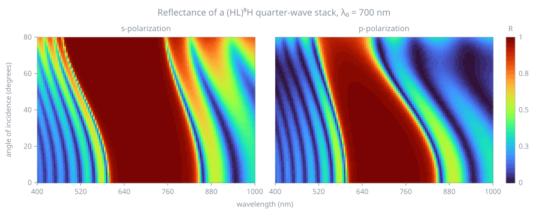

# tmmcore

Transfer-matrix method for multilayer thin-film optics, with exact analytic derivatives.

Takes a stack of layers and returns reflectance, transmittance and absorptance for absorbing and dispersive materials, at any angle of incidence, in s and p polarization. Alongside the spectra it returns the exact thickness Jacobian, the exact thickness Hessian, and the needle-insertion P-function.



<div class="grid cards" markdown>

-   __Analytic derivatives__

    The thickness Jacobian, the thickness Hessian and the needle P-function, computed exactly rather than by finite differences.

-   __Phase dispersion__

    Group delay, GDD and TOD as exact frequency derivatives, so they do not depend on the wavelength grid. Their thickness derivatives come from the same call.

-   __Node and the browser__

    JavaScript with no dependencies, and an optional WebAssembly build of the C.

-   __Python__

    The same C kernel as a wheel for your platform, with numpy arrays in and out. See [Python](python.md).

-   __C99__

    The kernel needs only libm and compiles as one file.

-   __Checkable__

    Four commands, needing only Node, rerun the accuracy checks in [Validation](validation.md).

</div>

## Install

```bash
npm install tmmcore
```

The WebAssembly binary ships prebuilt, so nothing is compiled at install time. For Python, `pip install tmmcore`.

## A first calculation

```js
import { rta } from 'tmmcore';

// A quarter-wave MgF2 layer on glass, at 550 nm, normal incidence.
const stack = {
    incident: 1.0,                                // ñ = n, or { n, k }
    substrate: 1.52,
    layers: [{ n: 1.38, d: 550 / (4 * 1.38) }],   // quarter wave, thickness in nm
};

const { R, T, A } = rta(stack, 550);

console.log(R);   // 0.012600790214630274
```

That value has a closed form, $R = \left(\frac{n_0 n_s - n_1^2}{n_0 n_s + n_1^2}\right)^2$; [Validation](validation.md#closed-forms) compares the two.

## Implementations

| | |
|---|---|
| **JavaScript** | The reference implementation. No dependencies. |
| **C** | A line-by-line port of the JavaScript. C99, libm only. |
| **WebAssembly** | The C, compiled. Opt-in, and over a wavelength grid about an order of magnitude faster than the JavaScript. |
| **Python** | The C, compiled for your platform and called through ctypes. |

The C matches the JavaScript to float64 round-off, and `npm test` checks it.

## Scope

tmmcore computes coherent stacks. An incoherent substrate, ellipsometric $\Psi$ and $\Delta$, and material data are left to the caller; the [examples](examples.md) build the first two on its calls. For a full design environment, see [TFStudio](https://github.com/aai2k/TFStudio).

## Licence

MIT.
